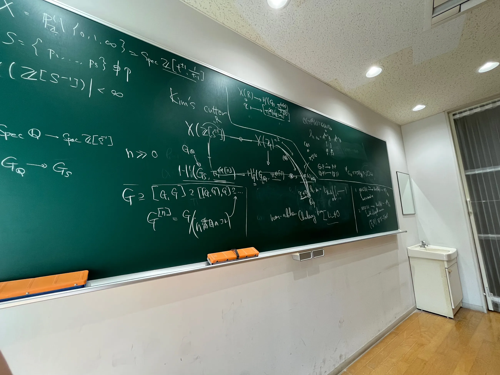

## 10/1（木）
今日も Cisinski を読んでいた．映像の世紀で AI の特集をしていて，Turing や von Neumann が取り上げられていたので最後まで見てしまった．

## 10/2（金）
今日から授業が始まった．今日は U 先生の授業で，相変わらず雑談全開だった．

[Joseph Rabinoff. The Theory of Witt Vectors](https://arxiv.org/pdf/1409.7445)：Witt 環について動機づけから含めて詳しく書かれていてとても良い．Witt 環の定義に現れる謎の構成が漸く腑に落ちた．

遠 Abel 幾何の人は $\mathbf{P}^1\setminus\{0,1,\infty\}$ を tripod と呼ぶらしい．モチーフ論や MZV の人は「射影直線引く三点」，"projective line minus three points" などというまどろっこしい名称を使うことが多いように思えるので，このような名前があると便利だと思った．

## 10/3（土）
今日はアルバイトがあった．少々面白いことがあったが，ここに書くと良くないと思うので書かない．しかし，そうしていると暫く経った後には忘れてしまっているだろう．

André の局所 Grothendieck–Teichmüller 群の論文は結構面白そうなことを言っている（local な場合，$\Q_p$ の絶対 Galois 群と Grothendieck–Teichmüller 群の変種のようなものがピッタリ一致することが示せるそうでビックリ！）ので読んでみたい気持ちが高まってきたが，Berkovich 空間の理論を使っているらしいので，読むとしたらそれを勉強しなければならなそうで少々面倒だ．いずれにせよいつか勉強する類のことならばさっさと勉強しておいた方が良いのだろうけれども．

## 10/4（日）
今日は頭が痛く，しかも眠かった．

最近は Olsson の non-abelian $p$-adic Hodge theory が気になっており，それを読むために logarithmic geometry が必要だそうなので，Ogus の logarithmic geometry の本を読み始めた．といっても最初の方は可換モノイド論なので，今日はずっと謎のモノイド論を読んでいた．可換モノイドなんて簡単だろうと思っていたが，群の場合とは違う振る舞いをすることが意外と多く，思っていたほど単純な話ではなかった．

Deligne に失礼な話だが，Deligne が Grothendieck に先んじて Weil 予想を証明してしまった時に Grothendieck が怒った理由は，現在 AI 企業が未解決問題を AI の性能のベンチマークとして利用することに対して数学者が怒っている理由とある程度パラレルかもしれないと，ふと思った．というのも，Grothendieck は motivic formalism によって（標準予想の解決を経て）Weil 予想（Riemann 予想）を解決することを望んでいたわけだが，Deligne はそのプログラムを無視して既にある道具で解いてしまったのだから，それはある意味で現在の数学者と AI 企業の対立と似た構図に似ているように感じられる．勿論，質的には全く異なる話だし，そもそも Deligne の証明はそのものとしてとても美しいものらしい（伝聞；私は読んだことがない）が……．

## 10/5（月）
今日は葉廣先生の量子不変量の授業の初回だった．冒頭に一時間近い膨大な予告編があり，それを聞く限りとても面白そうだったので多分履修すると思うが，予告編はもう少し短くても良いのではないかとも思った．Habiro ring が本来の文脈で出てきて感慨深かった．

今日もモノイド論の修行をしていた．Ogus の本は「ログ幾何にのみ興味がある人は取り敢えずこの節だけを読めば良い」と序文に書いてあるので，とても有難い．実際にはそこに書かれていない概念も必要になるので，それだけでは実は足りないのだが，しかしそれらを拾ったとしてもかなり労力を節約できる．

[加藤和也「log 幾何と Hodge 構造」](https://www.jstage.jst.go.jp/article/emath1996/1999/Autumn-Meeting1/1999_Autumn-Meeting1_31/_pdf/-char/ja)によると log というのは love of girl らしい．

## 10/6（火）
白石先生の授業があった．今日はずっと謎の $q$ 級数の変形をしていたのだが，あのような級数変形はどのような指針のもと行えば見えてくるのか皆目見当もつかない．次回からは概念的な背景の話に入るらしいので楽しみだ．

今日もモノイド論を進めた．段々面倒になってきた．

9 日の早稲田整数論セミナーに申し込んだ．川村さんが Grothendieck–Teichmüller 群の話をするらしい．

## 10/7（水）
OpenAI が 400 問近くに上る未解決問題の証明を Lean による形式化付きで発表した：https://github.com/openai/math

私が理解できるのはごく一部だが，Riemann ゼータ関数の零点が $\Re(s) > 7/8$ には存在しないことが示せたようで，これは結構驚きだ．それから，Grothendeick–Teichmüller Lie 代数が $\mathbf{Z}$ の mixed Tate motivic Lie algebra と同型である（従って motivic relation と associator relation が等価である）ことも証明できたらしい．

今日は坂井先生の Nevanlinna 理論の授業があった．本当の目的は Nevanlinna 理論よりも寧ろ Painlevé 方程式を紹介することだそうだが，よく考えてみるとその為には Nevanlinna 理論は最適ではなかったかも知れないと仰っていた．三限は代数的整数論があった．こちらは殆どが知っている内容だろうから受ける必要はほぼないと思うのだが，単位が大量に余っていた学部時代とは違って，一応卒業単位を稼がないといけないので，邪道ではあるが単位の為に取ることにした．来週からも授業に出席するかは分からない．

夜はヴァイオリンがあった．今までに何度か書いている通り，今月末に発表会があるが，完成度があまり芳しくなくて少々不安なところだ．

## 10/8（木）
今日は Lie 群の授業があった．Lie 群は全く知らないわけではないが，色々と誤魔化しながら使っていたので，折角なので授業でしっかり勉強してみようと思っている．

授業後は来週の水曜日の Cisinski のゼミの準備をする予定だったのだが，コモンルームでダラダラして時間を潰してしまった．後輩が最近 nearby functor を勉強したそうで，nearby cycle の定義があまりにも見事であるという話で共感してくれる人が増えて嬉しい．

その後は友人たちと新宿の TOHO シネマズで《ワルプルギスの廻天》を再び観てきた．

ネタバレを含む感想

これまでに書いたことと重複するかも知れないが，《廻天》では「名指すこと」や「言語を用いて識別・記憶されること」によって個々の人格の尊厳を保つこと，あるいはその人物を世界の内に固定することという形而上学的な主題（名塚底根はまさにそのような形而上学的な観念の象徴ではないかと思う）が扱われており，マルグリート（= ワルプルギスの夜）はそのような形而上学的な世界を管轄していると考えられるが，それに対するアンチテーゼとしてニーチェ的な意味での「超人」「大地の意味」たる暁美ほむらが配置されている．

さやかの魔女化の教訓が「人は完全に他人の為に行動できるほど強くない」ということならば，《叛逆》以降の教訓は「人は完全に自分の為に行動できるほど強くもない」ということであり，逆に言えば全ての責任の始点と終点を大義や体系ではなく自分自身に帰すことのできる強さはエゴイズムであれある種の徳であると言える．名塚底根が言語による形而上学的な救済（失脚して処刑を待つ身となったボエティウスが獄中で『哲学の慰め』を認めたように……），円環の理が慈愛による救済であるのに対して，暁美ほむらが抱くのは「今，ここに」あることへの愛・執着である．このように極めて個人的でしかも偶然性によって規定された不条理な執着こそが我々の生の実態に他ならないが，果たして我々はそれを真に愛しているか？　自身の身ひとつを唯一の根拠として，我々は何の意味もない「今，ここ」を愛し得るか？

## 10/9（金）
昨日で授業が一巡して今日は植田先生の講義の二回目があった．雑談ではずっと数日前の OpenAI の騒動のことを話していた．

その後は今学期最初のセミナーがあった．夏休みに勉強したポリログのこと（Beilinson–Deligne や Dupont のサーベイなど）と最近少し考えていることについて話すつもりだったが，後者について話していたらそれで良い時間になってしまったのでポリログの話は結局しなかった．今日話したのはざっくりとした研究計画（仮）だったのだが，もし誰も考えていないのだったら修論として良さそうだと言われたので，このまま考えてみることにする．ただ，誰かが既に考えていてもおかしくはないような話なので，他大学のとある先生に先行研究の存在などについて話を聞いてみると良いのではないかとも言われた．早速その先生にメールを送った．優しい先生だとは聞いたが，やはり緊張する．

取り敢えず今後やるべきことは明確になったので，少々大変な道のりにはなりそうだが頑張ってみよう．

セミナーの後，早稲田に行って整数論セミナーに参加した．多重ゼータ値（やその拡張）の関係式族（Grothendeick–Teichmüller 群，複シャッフル群，Kashiwara–Vergne 群）の話で，私が関心を持っていることと近くはあるけれども全然知らない方面の話だったので新しく知ったことがたくさんあった．こんなに面白い話題があるとは知らなかった．

## 10/10（土）
アルバイトがあった．今日は殆ど何もしていない．そろそろ Cisinski のゼミの準備をしないといけないが，明日から連日予定があり，雲行きがかなり怪しい．

## 10/11（日）
朝はアルバイトの会議があった．その後は高木レクチャーに行って Clausen の講演を聞いた．類体論は大昔に勉強したことがあったのだが，当時はまだあまり理解していなかったので，改めて聞いてみると面白かった．また時間があるときに勉強し直してみたいと思った．明日の講演が楽しみだ．Clausen は話が上手で面白かった．あと身長が高い．

高木レクチャーは参加費を徴収していないにも拘らず，参加者全員に分厚い資料が配布されていて太っ腹だと思った．講演の内容が復習できるのでとてもありがたい．

高木レクチャーの前後で SNS で繋がっていた何人かの人々と実際に会うことができた．最近になって漸く分かってきたのだが，浅学美少女というアカウントは意外と結構知名度が高いらしい．

中高生の頃に数理空間トポスでお世話になっていたチューターの方を見かけたのだが，話しかけるタイミングを見つけられなかった．明日は話しかけたい．

## 10/12（月）
高木レクチャーの二日目．今日の Clausen の講演は難しかったが，なるほど今を時めく人々はこういう風に数論を見ているのかという雰囲気は何となく感じ取れた．某氏は指導教員から「Clausen の話なんかを聞いたら当てられて修論どころではなくなるだろうから高木レクチャーには行くな」と言われたそうだが，確かにこれは当てられるなあと思った．

昼休みは友人とラウンジで喋っていた．Kim の non-abelian Chabauty method の話をした．

</img>

アルコールは飲まないのでワインパーティーには参加しなかったのだが，後から聞いたところではワイン以外にも色々な食料があったようなので，高々 500 円の参加費だったし行っても良かったと思った．研究集会や勉強会は大学（院）生や数学者たちの懇親も兼ねているのだということが最近になって（整数論サマースクールに参加したあたりから）漸く分かってきた．尤も，分かってからも悉く参加失敗しているのだが……（ポリログ然り，高木レクチャー然り）．

高木レクチャーの後は院生室で Cisinski のゼミの準備をする予定だったが，友人たちが来たので色々と雑談をしてしまった．その友人の院生室には余りにもよく回る椅子があり，回り心地が癖になるので高速で回転していたら気分が悪くなった．もう二度と回転しない．ゼミの準備は帰ってから進めた．

明日からは今度は $p$ 進コホモロジーの研究集会がある．明日の夕方には Clausen が代数学コロキウムで講演をするそうだが，ゼミの準備の進み具合によって参加を決めようと思う．

今更ながら，先月リリースされた Himari のアルバムを聴いた．神童だなどというレベルではなく，大人のプロと比べても遜色のない演奏で驚いた．
<iframe data-testid="embed-iframe" style="border-radius:12px" src="https://open.spotify.com/embed/album/7ubycHRiKPW2ZlCMnr4YeP?utm_source=generator&si=3d7a7970dc874e6d" width="100%" height="152" frameBorder="0" allowfullscreen="" allow="autoplay; clipboard-write; encrypted-media; fullscreen; picture-in-picture" loading="lazy"></iframe>

来年の秋に RIMS で開かれる [Arithmetic and motives](https://ahgt.math.cnrs.fr/AHG-year_27-28/Season-B/Workshop-Motives_Homotopy.html) というワークショップに Ayoub が来るらしい．Ayoub の論文は多少読んだので是非行きたい！　2027, 28 年度の Arithmetic, Homotopy, and Geometry のシリーズは全て面白そうで興味があるのだが，流石にその度に京都に行くことは出来ないから悩ましいところだ．例えば [The homology-homotopy frontier in arithmetic geometry](https://ahgt.math.cnrs.fr/AHG-year_27-28/Season-B/Conference-B.html) などの面子もとても豪華だ．私が先学期のセミナーで論文を読んだ Dan-Cohen も来る．